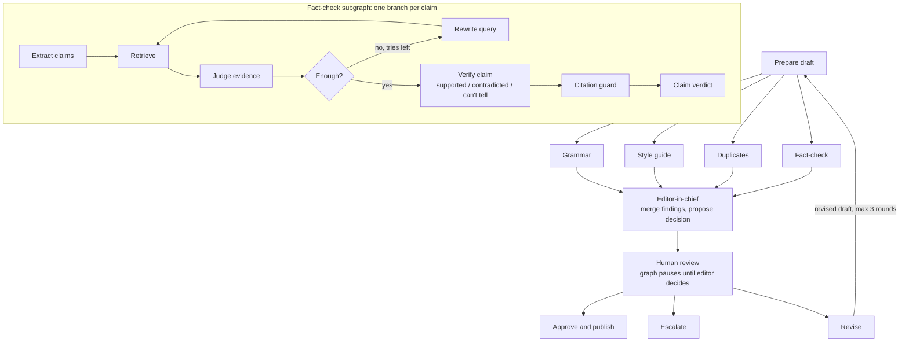

# Phase 0: Clean foundation

## Goal

Renovate before adding rooms. Phase 0 adds **no new features**: the app still reviews grammar and style and returns the same JSON. Afterwards:

- the code is split into layers with one job each, so new agents plug in easily;
- agents run as nodes in a LangGraph graph with typed state (the agentic backbone for later phases);
- calls to Claude return validated structured output, with retries, timeouts and a record of tokens and cost;
- tests run without calling the real API, and CI runs on every push;
- the README explains how to run, test and read the code.

## Layered architecture

Each layer only calls the layer below it. Shared folders (`core/`, `models/`) are used by every layer.

```mermaid
flowchart TD
    fe[Next.js frontend<br/>unchanged] -->|POST /review| api
    subgraph app[backend/app]
        api[api/<br/>routes only: HTTP in, JSON out] --> wf
        wf[workflows/<br/>LangGraph graph: which agents run, in what order] --> agents
        subgraph agents[agents/]
            base[BaseAgent<br/>load prompt, call LLM, validate]
            grammar[GrammarAgent] -.extends.-> base
            style[StyleAgent] -.extends.-> base
        end
        agents --> llm
        subgraph llm[llm/: the only code that talks to a model]
            oll[OllamaClient<br/>local, free: default]
            anth[AnthropicClient<br/>Claude API, paid]
        end
        core[core/<br/>settings, logging]
        models[models/<br/>Pydantic schemas]
    end
    oll --> ollama[Ollama on this machine]
    anth --> claude[Claude API]
    tests[tests/<br/>pytest + FakeLLM in fakes.py] --> ci[GitHub Actions CI]
```

| Folder | Its one job | Belongs here if it... |
| --- | --- | --- |
| `api/` | Receive HTTP requests, return responses | knows about URLs or status codes |
| `workflows/` | Build and run the LangGraph graph | combines agents or defines edges |
| `agents/` | One kind of review: a prompt + an answer shape | is about what to check |
| `agents/prompts/` | Prompt text files | is prompt wording |
| `llm/` | Call an AI model reliably, behind one interface | is about how to call a model |
| `models/` | Data shapes (Pydantic) shared by all layers | is a data structure |
| `core/` | Settings from `.env`, logging | is configuration |
| `tests/` | Prove each layer works on its own | is a test |

### Target folder structure

```
backend/
  app/
    main.py            app factory: builds settings, LLM client, graph on startup
    api/               review.py (POST /review), health.py (GET /health)
    core/              config.py (pydantic-settings), logging.py
    llm/               base.py (LLMClient, Usage), ollama.py, anthropic.py, pricing.py, factory.py
    agents/            base.py, grammar.py, style.py, prompts/<agent>/system.txt + user.txt
    workflows/         state.py (ReviewInput, ReviewState, ReviewUpdate), review_graph.py
    models/            review.py (Issue, AgentResult, ReviewResponse)
  tests/             test_*.py, fakes.py (FakeLLM, test-only)
  pyproject.toml       dependencies and tool config via uv
.github/workflows/ci.yml
```

## Agent graph in Phase 0

Only the existing agents, as graph nodes running in parallel. No fact-checking yet.

```mermaid
flowchart LR
    start([START]) --> prepare[Prepare draft]
    prepare --> grammar[Grammar]
    prepare --> style[Style]
    grammar --> merge[Merge results]
    style --> merge
    merge --> done([END: same JSON as today])
```

- **State (`ReviewState`):** a typed dict carrying `article`, `grammar_result`, `style_result`, `response`, and a `usage` list that each node appends its LLM usage to (a LangGraph reducer, so parallel nodes don't overwrite each other). `ReviewInput` (just `article`) is what a review starts with; `ReviewUpdate` is the partial dict a node returns.
- **Prepare draft** trims the article and unifies line endings. **Merge results** builds `ReviewResponse` and logs one line per review with calls, tokens, LLM time and cost.
- **Errors:** if an agent fails, the whole review fails with that `LLMError` (same as before). Partial results (one agent's answer when the other failed) are left for a later phase, because the frontend would need to change.
- `build_review_graph(llm)` compiles the graph; `run_review(graph, article)` returns the response and all usage records.
- **Nodes** are thin wrappers: each calls one agent and returns only the state keys it changes.
- **The graph is compiled once at startup** and handed to the API route.
- No checkpointer, human pause or loops yet. Those arrive in later phases.

### How the graph grows

| Phase | Added to the graph |
| --- | --- |
| 0 | Prepare draft → Grammar and Style in parallel → Merge results |
| 1 | Fact-check subgraph, straight line: Extract claims → Retrieve → Verify claim |
| 4 | Judge evidence, the "enough?" loop with Rewrite query, Citation guard |
| 5 | Style-guide and Duplicates agents with retrieval; Editor-in-chief; Human review pause; Postgres checkpoints; revise loop |

Target graph (for orientation, not built in Phase 0):



## One review request, step by step

1. The frontend sends the article to `POST /review`.
2. `api/review.py` validates the body and invokes the compiled graph (created at startup).
3. The graph runs Prepare draft, then Grammar and Style in parallel, then Merge results.
4. Each agent uses `BaseAgent`: load its prompt file, fill in the article, call `llm.generate_structured(prompt, AgentResult)`.
5. `AnthropicClient` sends the prompt with the `AgentResult` schema as a tool, so Claude must answer in that shape. It retries on rate limits or invalid output, applies a timeout and returns the result with a `Usage` record (model, tokens, latency, estimated cost).
6. The API returns the same JSON as today.

## LLM layer

- **Interface `LLMClient`:** async `generate(prompt, system=None, tier="fast") -> LLMResponse[str]` and `generate_structured(prompt, schema, system=None, tier="fast") -> LLMResponse[schema]` ([ADR 0004](../decisions/0004-async-llm-calls.md)).
- **Model tiers:** agents ask for `"fast"` or `"strong"`; the client maps the tier to a model name from settings, so agents never name a model or provider.
- **Errors:** `LLMError` for failed calls, `LLMOutputError` when the answer does not fit the schema.
- **Providers** ([ADR 0006](../decisions/0006-local-models-with-ollama.md)): `OllamaClient` (local, free, default) and `AnthropicClient` (Claude, paid), chosen by `LLM_PROVIDER`. No OpenAI client in Phase 0.
- **Structured output via JSON outputs** ([ADR 0005](../decisions/0005-json-outputs-for-structured-answers.md)): the Pydantic schema is sent as the answer format (`output_config.format` for Claude, `format` for Ollama). The answer is validated with Pydantic; one retry on validation failure. Refusals and cut-off answers raise their own errors.
- **Reliability:** timeout; for Claude, the SDK's retries with exponential backoff on rate-limit, server and network errors (`LLM_MAX_RETRIES`). A local Ollama server has no rate limits, so no backoff; a stopped server or missing model gives a clear error.
- **Usage record** per call: model, input/output tokens, latency, estimated cost (`pricing.py`; local models cost 0). Tokens of a retried attempt are included. Logged and returned, so the Phase 7 cost dashboard has data from day one.
- **Models from settings:** no hard-coded model names.
- **`FakeLLM`:** returns canned responses for tests. Lives in `tests/fakes.py`, not `app/`, because only tests use it.
- The duplicate `services/llm/llm_service.py` is deleted.

## Agents

- `BaseAgent` holds the shared work: load prompts, fill in the article, call `generate_structured`. Each agent declares only `name` (its prompt folder), and optionally `output_schema` and `tier` (default `fast`).
- **Two prompt files per agent:** `prompts/<agent>/system.txt` is the job description (what to check, how to report, the score scale); `prompts/<agent>/user.txt` is the message with an `{article}` slot, the article wrapped in `<article>` tags. Instructions and article stay separate, so text in an article is not taken as an instruction. Prompts contain no JSON instructions: the LLM layer enforces the answer shape.
- **Score scale:** 0 to 100, 100 means no problems. Stated in the system prompts and enforced by `AgentResult` (an out-of-range score counts as an invalid answer and is retried once).
- `review(article)` returns `LLMResponse[AgentResult]`: the result and its `Usage`, which the graph collects.
- Agents receive the `LLMClient` in their constructor (dependency injection) and never create clients themselves.

## API

- Settings load once via `pydantic-settings`; the LLM client and graph are created at startup, so a missing key fails with a clear message instead of an import-time crash.
- The app is built by a factory, `create_app(settings=None, llm=None)`, started with `uvicorn --factory app.main:create_app`; tests pass their own settings and a `FakeLLM`.
- Errors: a blank article returns 422; `LLMError` (model unreachable, timeout) returns 503; `LLMOutputError` (invalid answer after a retry) returns 502. The `detail` says what went wrong.
- `make dev` runs the backend without Docker. In Docker, `OLLAMA_HOST` points at the Mac (`host.docker.internal`), because Ollama runs natively to use the GPU. The unused root `docker-compose.yml` is removed; `backend/docker-compose.yml` is the only one.
- `POST /review` keeps the current response shape (`grammar_result`, `style_result`), so the frontend does not change.
- `GET /health` added: `{"status": "ok", "provider": ...}`.

## Quality and tooling

- **uv** + `pyproject.toml` replace `requirements.txt`.
- **ruff** (lint and format), **pyright** (types), **pytest**.
- **Tests:** prompt loading; agent parsing with `FakeLLM`; LLM client retry and validation logic with a mocked SDK; the graph end to end with `FakeLLM`; the API via FastAPI's test client. A real-API test runs only when `ANTHROPIC_API_KEY` is set.
- **GitHub Actions:** lint, type check and tests on every push and pull request.

## Commit plan

Work happens on branch `phase-0`, merged into `redesign` by pull request. Every commit leaves the app working. Follow the implementation workflow in `AGENTS.md`: explain before each commit, explain module by module after it, then stop for review.

| # | Commit | Contents | Status |
| --- | --- | --- | --- |
| 1 | Project tooling | `pyproject.toml` + `uv.lock` replace `requirements.txt`; ruff, pyright, pytest config; Dockerfile installs from the lock; Makefile targets. No app code changes | done |
| 2 | Settings and logging (`core/`) | `config.py` with pydantic-settings (API keys, model names, timeouts) from `.env`; `.env.example`; `logging.py`; tests | done |
| 3 | LLM interface and fake (`llm/base.py`, `tests/fakes.py`) | `LLMClient` (`generate`, `generate_structured`), `LLMResponse`, `Usage`; `FakeLLM`; tests. Not used by the app yet | done |
| 4 | Real LLM clients (`llm/ollama.py`, `llm/anthropic.py`) | Ollama (default, free) and Anthropic clients; structured output via JSON outputs, Pydantic validation + one retry, timeout, SDK backoff on rate limits, token/latency/cost tracking; `pricing.py`, `factory.py`; settings switch to Ollama; ADRs 0005 and 0006; tests with stand-in SDKs | done |
| 5 | Agents on the new base (`agents/`, `models/`) | `BaseAgent` with injected `LLMClient` and `output_schema`; slim `GrammarAgent`/`StyleAgent`; separate system and user prompt files per agent, without JSON instructions; score 0-100; `models/review.py`; new files next to the old ones until commit 7; tests with `FakeLLM` | done |
| 6 | LangGraph graph (`workflows/`) | `ReviewState` with a usage reducer; Prepare draft -> Grammar and Style in parallel -> Merge results; `langgraph` dependency; `FakeLLM` responder for parallel tests; tests running the graph with `FakeLLM`, including a proof that the agents run at the same time | done |
| 7 | API wiring, remove old code (`api/`, `main.py`) | App factory builds settings, LLM client and graph at startup; `POST /review` (same response) and `GET /health`; delete `routes/`, `services/`, `utils/`, old workflow and the `openai` package; Docker reaches host Ollama (`OLLAMA_HOST`); remove root `docker-compose.yml`, `python-dotenv`; `make dev`; quiet `httpx` logs; API tests; manual check against real Ollama (local and Docker) | done |
| 8 | CI | GitHub Actions: ruff, pyright, pytest on push and PR; pre-commit config; real-API test only when a key is set | todo |
| 9 | Documentation | README; `architecture/current-state.md`; this file's Outcome; `MAP.md` | todo |

Update the Status column as each commit lands.

## Decisions

- [ADR 0002](../decisions/0002-tech-stack.md): tech stack.
- [ADR 0003](../decisions/0003-langgraph-from-phase-0.md): LangGraph from Phase 0.
- [ADR 0004](../decisions/0004-async-llm-calls.md): async LLM calls.
- [ADR 0005](../decisions/0005-json-outputs-for-structured-answers.md): JSON outputs for structured answers.
- [ADR 0006](../decisions/0006-local-models-with-ollama.md): local models with Ollama for development.

## Done when

- [ ] CI is green on every push (ruff, pyright, pytest).
- [ ] The frontend review works exactly as before.
- [ ] Grammar and Style run as parallel nodes in a LangGraph graph.
- [ ] Every LLM call logs model, tokens, latency and estimated cost.
- [ ] README explains how to run, test and read the code.
- [ ] `architecture/current-state.md` and `MAP.md` reflect the new structure.

## Outcome

To be filled in when the phase is complete.
