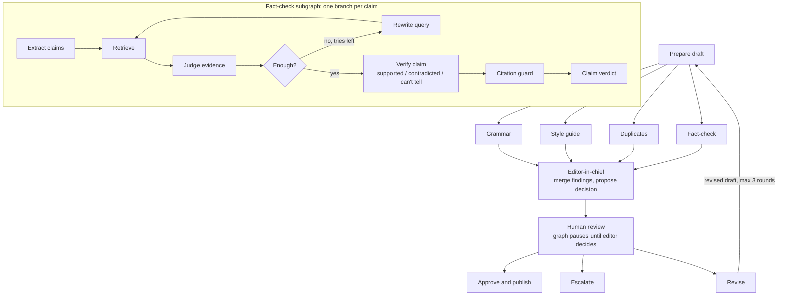

# Phase 0: Clean foundation

## Goal

Renovate before adding rooms. Phase 0 adds **no new features**: the app still reviews grammar and style and returns the same JSON. Afterwards:

- the code is split into layers with one job each, so new agents plug in easily;
- agents run as nodes in a LangGraph graph with typed state (the agentic backbone for later phases);
- calls to Claude return validated structured output, with retries, timeouts and a record of tokens and cost;
- tests run without calling the real API, and CI runs on every push;
- the README explains how to run, test and read the code.

## Layered architecture

Each layer only calls the layer below it. Shared folders (`core/`, `models/`) are used by every layer.

```mermaid
flowchart TD
    fe[Next.js frontend<br/>unchanged] -->|POST /review| api
    subgraph app[backend/app]
        api[api/<br/>routes only: HTTP in, JSON out] --> wf
        wf[workflows/<br/>LangGraph graph: which agents run, in what order] --> agents
        subgraph agents[agents/]
            base[BaseAgent<br/>load prompt, call LLM, validate]
            grammar[GrammarAgent] -.extends.-> base
            style[StyleAgent] -.extends.-> base
        end
        agents --> llm
        subgraph llm[llm/: the only code that talks to a model]
            anth[AnthropicClient<br/>tool use, retries, timeout, usage log]
            oai[OpenAIClient<br/>optional]
            fake[FakeLLM<br/>used by tests]
        end
        core[core/<br/>settings, logging]
        models[models/<br/>Pydantic schemas]
    end
    anth --> claude[Claude API]
    tests[tests/<br/>pytest + FakeLLM] --> ci[GitHub Actions CI]
```

| Folder | Its one job | Belongs here if it... |
| --- | --- | --- |
| `api/` | Receive HTTP requests, return responses | knows about URLs or status codes |
| `workflows/` | Build and run the LangGraph graph | combines agents or defines edges |
| `agents/` | One kind of review: a prompt + an answer shape | is about what to check |
| `agents/prompts/` | Prompt text files | is prompt wording |
| `llm/` | Call an AI model reliably, behind one interface | is about how to call a model |
| `models/` | Data shapes (Pydantic) shared by all layers | is a data structure |
| `core/` | Settings from `.env`, logging | is configuration |
| `tests/` | Prove each layer works on its own | is a test |

### Target folder structure

```
backend/
  app/
    main.py            app factory: builds settings, LLM client, graph on startup
    api/               review.py (POST /review), health.py (GET /health)
    core/              config.py (pydantic-settings), logging.py
    llm/               base.py (LLMClient interface, Usage), anthropic.py, openai.py, fake.py
    agents/            base.py, grammar.py, style.py, prompts/
    workflows/         state.py (ReviewState), review_graph.py
    models/            review.py (Issue, AgentResult, ReviewResponse)
  tests/
  pyproject.toml       dependencies and tool config via uv
.github/workflows/ci.yml
```

## Agent graph in Phase 0

Only the existing agents, as graph nodes running in parallel. No fact-checking yet.

```mermaid
flowchart LR
    start([START]) --> prepare[Prepare draft]
    prepare --> grammar[Grammar]
    prepare --> style[Style]
    grammar --> merge[Merge results]
    style --> merge
    merge --> done([END: same JSON as today])
```

- **State (`ReviewState`):** a typed dict carrying `article`, `grammar_result`, `style_result`, and a `usage` list that each node appends its LLM usage to (a LangGraph reducer, so parallel nodes don't overwrite each other).
- **Nodes** are thin wrappers: each calls one agent and returns only the state keys it changes.
- **The graph is compiled once at startup** and handed to the API route.
- No checkpointer, human pause or loops yet. Those arrive in later phases.

### How the graph grows

| Phase | Added to the graph |
| --- | --- |
| 0 | Prepare draft → Grammar and Style in parallel → Merge results |
| 1 | Fact-check subgraph, straight line: Extract claims → Retrieve → Verify claim |
| 4 | Judge evidence, the "enough?" loop with Rewrite query, Citation guard |
| 5 | Style-guide and Duplicates agents with retrieval; Editor-in-chief; Human review pause; Postgres checkpoints; revise loop |

Target graph (for orientation, not built in Phase 0):



## One review request, step by step

1. The frontend sends the article to `POST /review`.
2. `api/review.py` validates the body and invokes the compiled graph (created at startup).
3. The graph runs Prepare draft, then Grammar and Style in parallel, then Merge results.
4. Each agent uses `BaseAgent`: load its prompt file, fill in the article, call `llm.generate_structured(prompt, AgentResult)`.
5. `AnthropicClient` sends the prompt with the `AgentResult` schema as a tool, so Claude must answer in that shape. It retries on rate limits or invalid output, applies a timeout and returns the result with a `Usage` record (model, tokens, latency, estimated cost).
6. The API returns the same JSON as today.

## LLM layer

- **Interface `LLMClient`:** `generate(prompt, system=None) -> LLMResponse[str]` and `generate_structured(prompt, schema, system=None) -> LLMResponse[schema]`.
- **Structured output via tool use:** the Pydantic schema becomes a tool definition and Claude is required to call it. The arguments are validated with Pydantic; one retry on validation failure.
- **Reliability:** timeout, retries with exponential backoff on rate-limit and server errors.
- **Usage record** per call: model, input/output tokens, latency, estimated cost. Logged and returned, so the Phase 7 cost dashboard has data from day one.
- **Models from settings:** no hard-coded model names.
- **`FakeLLM`:** returns canned responses for tests.
- The duplicate `services/llm/llm_service.py` is deleted.

## Agents

- `BaseAgent` holds the shared work: load prompt, call the LLM, validate. Each agent declares only `prompt_file` and `output_schema`.
- Agents receive the `LLMClient` in their constructor (dependency injection) and never create clients themselves.

## API

- Settings load once via `pydantic-settings`; the LLM client and graph are created at startup, so a missing key fails with a clear message instead of an import-time crash.
- `POST /review` keeps the current response shape (`grammar_result`, `style_result`), so the frontend does not change.
- `GET /health` added.

## Quality and tooling

- **uv** + `pyproject.toml` replace `requirements.txt`.
- **ruff** (lint and format), **pyright** (types), **pytest**.
- **Tests:** prompt loading; agent parsing with `FakeLLM`; LLM client retry and validation logic with a mocked SDK; the graph end to end with `FakeLLM`; the API via FastAPI's test client. A real-API test runs only when `ANTHROPIC_API_KEY` is set.
- **GitHub Actions:** lint, type check and tests on every push and pull request.

## Decisions

- [ADR 0002](../decisions/0002-tech-stack.md): tech stack.
- [ADR 0003](../decisions/0003-langgraph-from-phase-0.md): LangGraph from Phase 0.

## Done when

- [ ] CI is green on every push (ruff, pyright, pytest).
- [ ] The frontend review works exactly as before.
- [ ] Grammar and Style run as parallel nodes in a LangGraph graph.
- [ ] Every LLM call logs model, tokens, latency and estimated cost.
- [ ] README explains how to run, test and read the code.
- [ ] `architecture/current-state.md` and `MAP.md` reflect the new structure.

## Outcome

To be filled in when the phase is complete.
