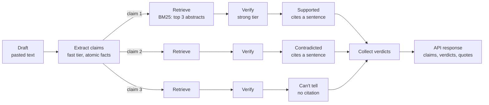

# Phase 1: Fact-check MVP

## Goal

The first time EditoralFlow does what it is for: **checking facts**. Paste a paragraph, and every factual statement in it is marked *supported*, *contradicted* or *can't tell*, with the exact source sentence that justifies the verdict.

It is the simplest version that works end to end: **find facts, look them up, decide with proof.** No smart search (Phase 3), no retry loop (Phase 4), no accuracy measurement yet (Phase 2).

## How a fact-check runs



The extractor turns the draft into claims. LangGraph starts one branch per claim (`Send`): each branch searches the library and asks the verifier for a verdict. A branch that finds nothing relevant ends as "can't tell" with no citation, never as a guess.

## The node graph

One fact-check subgraph, two ways in.

```mermaid
flowchart LR
    subgraph review[Review graph: POST /review]
        prepare[prepare_draft] --> grammar[grammar] & style[style] & fc[fact_check<br/>optional]
        grammar & style & fc --> merge[merge_results] --> rresp[response<br/>+ fact_check_result]
    end
    fc -. same subgraph, only if REVIEW_INCLUDE_FACT_CHECK=true .-> sub
    subgraph sub[Fact-check subgraph: POST /fact-check runs it alone]
        extract[extract_claims<br/>fast tier] -->|Send, one per claim| check
        subgraph check[check_claim]
            retrieve[retrieve] --> verify[verify]
        end
        check --> collect[collect<br/>verdicts + usage]
    end
```

- The subgraph is compiled once and used in two places: alone behind `/fact-check`, and as the `fact_check` node of the review graph when `REVIEW_INCLUDE_FACT_CHECK=true` (off by default, because fact-checking makes many model calls).
- `collect` gathers verdicts and usage records through reducers, like `usage` in the review graph.

## Where the new code goes

```
backend/
  app/
    retrieval/                NEW: the source library and search
      corpus.py               load SciFact abstracts (doc id, title, sentences)
      base.py                 Retriever interface + Passage model
      bm25.py                 BM25Retriever (bm25s), built once at startup
    agents/
      base.py                 CHANGED: generic answer shape, named prompt slots
      claim_extractor.py      NEW: draft -> list of claims (fast tier)
      verifier.py             NEW: claim + passages -> verdict (strong tier)
      prompts/claim_extractor/, prompts/verifier/   NEW
    models/
      fact_check.py           NEW: Claim, Citation, Verdict, ClaimResult, FactCheckResponse
    workflows/
      fact_check_state.py     NEW: FactCheckState (results + usage reducers)
      fact_check_graph.py     NEW: subgraph: extract -> Send per claim -> retrieve + verify -> collect
      review_graph.py         CHANGED: optional fact-check branch (REVIEW_INCLUDE_FACT_CHECK)
    api/
      fact_check.py           NEW: POST /fact-check
    main.py                   CHANGED: load corpus, build retriever + fact-check graph at startup
    core/config.py            CHANGED: corpus path, top_k, max_claims, review_include_fact_check
  scripts/
    download_scifact.py       NEW: fetch the corpus once into backend/data/ (gitignored)
  tests/                      NEW tests with a tiny fixture corpus + FakeLLM
frontend/src/app/page.tsx     CHANGED: Review | Fact-check tabs, highlighted claims
```

## Source library and search

- **Corpus:** the SciFact corpus, about 5,000 abstracts from science and health papers, already split into numbered sentences. A script downloads it once into `backend/data/` (gitignored); `make data` runs it.
- **Unit of search:** a whole abstract. The verifier then reads the top abstracts sentence by sentence.
- **Search:** BM25 keyword search with `bm25s`, indexed in memory at startup. No extra service.
- **Why keyword search only, for now:** it is the measured baseline. Phase 2 measures how often search finds the right abstract; Phase 3 adds vector search and a reranker and shows the improvement against it. Scientific claims share exact terms with their papers, so BM25 is a strong start on SciFact.
- **Top k:** 3 abstracts per claim (a setting).
- **`Retriever` interface:** async `search(query, k) -> list[Passage]` (async like the LLM layer, for Phase 3's database-backed search). Phase 3 adds a hybrid retriever behind it.
- **Matching:** title and abstract are indexed together; words are lowercased, stemmed and stopwords dropped. Abstracts sharing no word with the claim (score 0) are left out, so a search can return fewer than k or none. On the real corpus a single shared word is usually enough to return something, so the verifier, not search, is what turns irrelevant results into "can't tell".
- **Tests** use a 5-abstract fixture corpus: fast, no download.

## The two new agents

**Claim extractor** (fast tier)

- Each claim is **atomic** (one fact) and **self-contained** ("It reduced deaths" becomes "Statins reduced deaths in heart patients").
- Each claim carries the **exact sentence of the draft it came from**, copied word for word, for highlighting.
- Opinions, questions and filler are skipped. At most 20 claims per draft (a setting).
- The model writes only `text` and `source_sentence`; the code drops empty and repeated claims (ignoring case and spacing), keeps the first `max_claims`, and numbers them `c1`, `c2`, .... The system prompt includes one worked example, which small local models follow better than rules alone.

**Verifier** (strong tier). Gets one claim plus the top 3 abstracts with numbered sentences.

- Returns a label (`supported`, `contradicted`, `not_enough_info` shown as "can't tell"), a one-sentence explanation, and **the numbers of the sentences it relies on**, not free-text quotes.
- The code looks those sentences up in the corpus to build each citation, so a quote can never be invented.
- **Proof-or-abstain guard in code:** `supported` or `contradicted` with no valid sentence numbers is downgraded to `not_enough_info`; numbers that don't exist are dropped.
- **How sources are shown:** abstracts are labelled Source A, B, C and all their sentences numbered 1..N in one sequence; the code keeps a map from each number to its abstract and sentence. The model's answer fields come in the order `explanation`, `sentence_numbers`, `label`, so it reasons before it decides. Repeated numbers are removed; `not_enough_info` never carries citations; a downgrade keeps the model's reason in the explanation.
- **No passages, no call:** if search returns nothing, the verdict is `not_enough_info` ("No relevant source was found in the library.") without asking the model.

**Answer shapes** (`models/fact_check.py`)

| Model | Fields |
| --- | --- |
| `Claim` | `id`, `text` (the atomic claim), `source_sentence` (exact words from the draft) |
| `Citation` | `doc_id`, `title`, `sentence_index`, `text` (looked up, never generated) |
| `Verdict` | `label`, `explanation`, `citations` |
| `ClaimResult` | `claim`, `verdict`, `retrieved_doc_ids` (for debugging and Phase 2) |
| `FactCheckResponse` | `results`, counts per label |

**`BaseAgent` change:** it becomes generic, `BaseAgent[R]`: each agent declares `output_schema`, its `slots` (e.g. `("claim", "passages")`) and `tier`. At creation `user.txt` must contain exactly those slots; `run(**values)` requires exactly those values and fills all slots in one pass, so slot-like text inside a value stays as written. `ReviewAgent` (answer `AgentResult`, slot `article`, method `review(article)`) is what grammar and style now extend, so the review graph and API are unchanged.

`FactCheckResponse.counts` is computed from `results`, never set separately.

## API and frontend

- **`POST /fact-check`** takes `{"article": "..."}` and returns a `FactCheckResponse`. Same error handling as `/review` (502 bad model output, 503 model unreachable).
- **`POST /review`** is unchanged by default; with `REVIEW_INCLUDE_FACT_CHECK=true` it also returns `fact_check_result`.
- **Frontend:** *Review* and *Fact-check* tabs. In Fact-check, each claim's source sentence is highlighted green, red or grey; clicking one opens a panel with the claim, explanation and cited sentence with the paper title. Claims whose source sentence can't be found in the text are listed below it.

## Decisions

| Decision | ADR |
| --- | --- |
| Science and health domain with SciFact; atomic claims; three labels | [0007](../decisions/0007-claims-and-labels.md) |
| Citations by sentence number, looked up in code | [0008](../decisions/0008-citations-by-sentence-number.md) |
| BM25 keyword search as the Phase 1 baseline | [0009](../decisions/0009-bm25-baseline.md) |
| Fact-check as a subgraph, alone and inside the review graph | [0010](../decisions/0010-fact-check-subgraph.md) |
| Models: extractor on fast tier, verifier on strong tier | follows [0006](../decisions/0006-local-models-with-ollama.md) |

## Commit plan

Branch `phase-1`, one pull request into `main`. Follow the implementation workflow in `AGENTS.md`.

| # | Commit | Contents | Status |
| --- | --- | --- | --- |
| 1 | Corpus | `scripts/download_scifact.py`, `make data`, `retrieval/corpus.py`, fixture corpus, tests | done |
| 2 | BM25 search | `Retriever` interface, `Passage`, `BM25Retriever` with `bm25s`, tests | done |
| 3 | Models and generic agent base | `models/fact_check.py`; `BaseAgent` with a generic answer shape and named slots; grammar/style tests still pass | done |
| 4 | Claim extractor | Agent, prompts, tests with `FakeLLM` | done |
| 5 | Verifier | Agent, prompts, sentence-number citations, proof-or-abstain guard, tests | done |
| 6 | Fact-check graph | Subgraph with reducers, `Send` per claim, retrieve + verify, collect; optional branch of the review graph; tests for both | todo |
| 7 | API | `POST /fact-check`, startup wiring, settings, `/review` flag, API tests | todo |
| 8 | Frontend | Tabs, highlighted claims, evidence panel | todo |
| 9 | Documentation | current-state, roadmap, MAP, this file's Outcome | todo |

## Done when

- [ ] `make data` downloads the corpus; the app starts with it indexed.
- [ ] Pasting a science paragraph shows coloured claims with real SciFact citations.
- [ ] A claim with no relevant source shows "can't tell" with no citation.
- [ ] Every citation's text exists word for word in the corpus.
- [ ] `make check` is green; `/review` works unchanged by default.
- [ ] A quick manual try on 5 SciFact claims is noted in the Outcome (real measurement is Phase 2).

## Outcome

To be filled in when the phase is complete.
