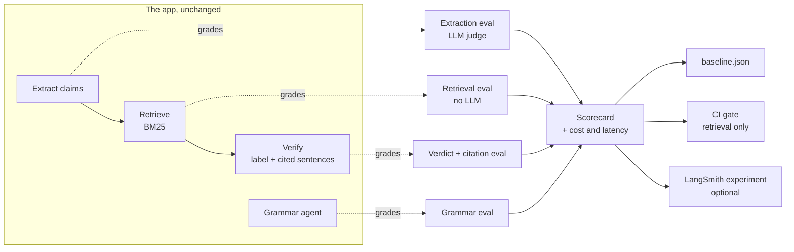

# Phase 2: Evaluation harness

## Goal

Right now nobody knows how good the fact-checker is. When a prompt, model or search changes, we can't tell whether it got better or worse. Phase 2 gives it an **exam with an answer key**, a **report card** after every run, and a **saved baseline** to compare against, so quality changes are visible like any other change.

Effort follows the product's promise:

| Part | How deeply it is evaluated |
| --- | --- |
| Fact-check (extract, retrieve, verify, cite) | Deeply, step by step |
| Grammar agent | Lightly, with errors planted on purpose |
| Style agent | Not scored until Phase 5 (no ground truth for "better style" yet) |
| Review graph as a whole | Structurally, by the existing tests; cost and latency on the scorecard |

## Each step gets its own exam

A single end-to-end score can say a result got worse but not *why*. Each step is graded separately, so a drop points to its cause.



### Oracle mode

When a verdict is wrong, either retrieval brought the wrong abstract or the verifier misread the right one. **Oracle mode** hands the verifier the gold abstract straight from the answer key, skipping retrieval. It exists only in the eval; the product never uses it.

| Normal mode | Oracle mode | Meaning |
| --- | --- | --- |
| Bad | Good | Retrieval is the weak link (Phase 3 targets it) |
| Bad | Bad | The verifier is the weak link (prompt or model) |

## Datasets

| Dataset | Source | Gives us | Used by |
| --- | --- | --- | --- |
| SciFact dev | `claims_dev.jsonl`, about 300 claims | Gold abstract(s), gold rationale sentence numbers, gold label (SUPPORT, CONTRADICT, or none = not enough info) | Retrieval, verdict, citations |
| Assembled paragraphs | Built by us: 15 to 20 short paragraphs mixing SciFact claims with filler and opinion sentences | Which sentences hold checkable claims, and each claim's gold verdict | Extraction, end-to-end |
| Grammar injected errors | Seeded script plants known mistakes (agreement, tense, articles, spelling) in clean abstract sentences | Position and fix of every planted error | Grammar |

Rules:

- **No tuning on dev.** If prompts get tuned against the scorecard, the SciFact train split is the tuning set and dev stays the report set.
- **Every dataset is a committed file or a seeded script**, so any number can be reproduced.
- **dev-100:** a fixed 100-claim sample (chosen once with a seed) for quick local runs, about 25 minutes with local models instead of an hour.

## Metrics

| Step | Metric | Plain question | LLM? |
| --- | --- | --- | --- |
| Retrieve | Recall@1, @3, @10 | Is the gold abstract in the top 1, 3, 10? | No |
| Retrieve | MRR | On average, how high is the gold abstract ranked? | No |
| Verify | Accuracy, macro-F1 | How often is the label right, weighting the three labels equally? | Yes |
| Verify | Confusion matrix | Which labels get mixed up? | Yes |
| Verify | Flip rate | How often is *supported* given for *contradicted*, or the reverse (the worst error)? | Yes |
| Verify | Abstention rate | How often is *not enough info* given? | Yes |
| Cite | Citation precision, recall | Are cited sentences the gold rationale sentences, and are all of them found? | Yes |
| Extract | Claim recall, precision | Is every checkable claim extracted, and nothing else? An LLM judge matches extracted to gold claims. | Judge |
| End-to-end | Paragraph verdict accuracy | From raw text, does each gold claim end with the right label? | Yes |
| Grammar | Error recall, precision | Are planted errors found, and how many are invented? | Yes |
| All | Cost and latency per claim | Dollars and seconds, from existing `Usage` records | No |

**The LLM judge** does one narrow job: "does extracted claim A mean the same as gold claim B?" It uses the strong tier at temperature 0 and is spot-checked by hand on 20 pairs before its numbers are trusted; the agreement rate is recorded.

## How it runs

```
make eval-retrieval          # all ~300 dev claims, seconds, no LLM
make eval                    # every eval on dev-100 with local models
make eval ARGS="--limit 20"  # quick smoke run
make eval-compare            # this run vs. baseline.json
```

- Each run writes `backend/evals/results/<date>-<run-id>/scorecard.json` (machines, CI) and `scorecard.md` (readable table, with every wrong answer listed underneath).
- Each run records its **configuration**: model names, prompt versions, retriever, dataset, sample size, git commit.
- `backend/evals/baseline.json` is the committed last-known-good scorecard. `make eval-compare` shows each metric against it and fails when a metric drops more than its margin. An intended improvement re-runs and commits the new baseline in the same pull request.
- `--langsmith` also uploads the run as a LangSmith **experiment** (dataset, examples, scores) for side-by-side comparison and click-through to traces. Opt-in; our own files stay the source of truth.
- Temperature 0, and a fixed seed where the provider supports one. Margins are wide enough that normal run-to-run noise does not fail the build.

### In CI

On every push and every pull request, alongside lint and unit tests:

1. Unit tests for every metric function (pure maths; FakeLLM is enough).
2. The **full retrieval eval** on all dev claims, compared with the baseline. Worse search turns the build red.

LLM evals run only locally for now. A paid Claude run in CI is deferred.

## Where the code goes

The harness sits beside the app. The app never imports from `evals/`; the evals import the real agents and graphs, so what ships is what gets tested.

```
backend/
  app/                      unchanged, except prompts get a version string
  evals/
    __main__.py             CLI: python -m evals run retrieval|verifier|extraction|e2e|grammar
    datasets.py             SciFact dev, dev-100, paragraphs, grammar cases
    metrics.py              pure functions: recall@k, MRR, F1, confusion, flip rate, citation P/R
    judge.py                the one LLM judge (claim matching)
    runners/
      retrieval.py          Retriever only
      verifier.py           verifier, normal and oracle mode
      extraction.py         claim extractor + judge
      end_to_end.py         full fact-check subgraph on paragraphs
      grammar.py            grammar agent on injected errors
    report.py               scorecard.json + scorecard.md, compare against baseline
    langsmith_upload.py     optional experiment upload
    data/
      paragraphs.jsonl      assembled paragraphs (committed)
      grammar_cases.jsonl   built by scripts/make_grammar_cases.py (seeded)
      dev100_ids.json       fixed sample
    baseline.json
    results/                git-ignored, except runs we choose to keep
  tests/evals/              unit tests for metrics, datasets and report
```

`metrics.py` is plain maths with no LLM, so it gets real unit tests; the runners are thin loops that call the app and pass results to those functions.

## Decisions

| # | Decision | ADR |
| --- | --- | --- |
| 1 | Own eval runner, with optional LangSmith experiments (replaces Langfuse from ADR 0002) | [0013](../decisions/0013-own-eval-runner-with-langsmith-experiments.md) |
| 2 | Step-wise evaluation with oracle mode, and one narrow, spot-checked LLM judge | [0014](../decisions/0014-step-wise-evaluation.md) |
| 3 | CI runs the free retrieval eval on every push and PR against a committed baseline; LLM evals run locally | [0015](../decisions/0015-ci-eval-gate.md) |
| 4 | Fact-check evaluated deeply, grammar lightly, style not scored until Phase 5 | This file (Goal) |

## Commit plan

One commit at a time: explain before, explain module by module after, then stop for the owner's go.

| # | Commit | Visible result | Status |
| --- | --- | --- | --- |
| 1 | **Datasets.** `evals/` package, SciFact dev loader, fixed dev-100 sample, tests | `python -m evals datasets` prints counts per label | planned |
| 2 | **Metrics.** `metrics.py`: recall@k, MRR, accuracy, macro-F1, confusion, flip rate, abstention, citation P/R, with unit tests | Tests pass on hand-made examples | planned |
| 3 | **Retrieval eval and first baseline.** Runner, scorecard writer, `make eval-retrieval` | First real number: BM25 recall@3 on SciFact dev | planned |
| 4 | **Verifier eval with oracle mode and citations.** Prompt version strings added to agents | Verdict and citation scores, normal vs. oracle | planned |
| 5 | **Paragraphs, extraction and end-to-end evals.** Paragraph file, the judge, both runners | Claim recall/precision and end-to-end accuracy | planned |
| 6 | **Grammar eval.** Seeded error-injection script and runner | Grammar recall/precision | planned |
| 7 | **Scorecard, compare and LangSmith.** Markdown report, `make eval-compare`, `--langsmith` | Readable scorecard and a LangSmith experiment | planned |
| 8 | **CI gate.** Retrieval eval in GitHub Actions against the baseline, on every push and PR | Red build if search gets worse | planned |
| 9 | **Full baseline run and docs.** Run everything, commit `baseline.json`, update `current-state.md`, roadmap, README results table, MAP | Phase 2 scorecard in the repo | planned |

## Done when

- `make eval` runs every eval and writes a scorecard readable in two minutes.
- Each fact-check step has its own score, and oracle mode shows whether retrieval or the verifier is the weak link.
- A committed baseline exists, and CI fails when retrieval quality drops.
- Any wrong verdict on the scorecard can be traced back to its inputs (and to LangSmith, if enabled).
- The docs explain every metric in plain English.

## Outcome

To be filled in when the phase ends.
